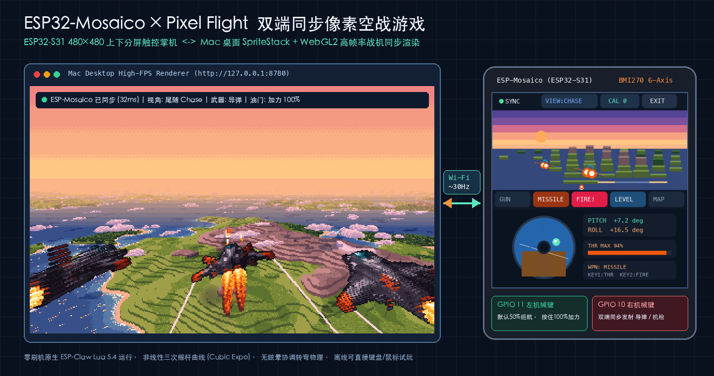
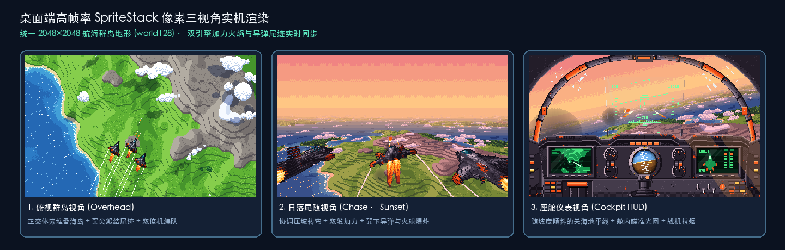
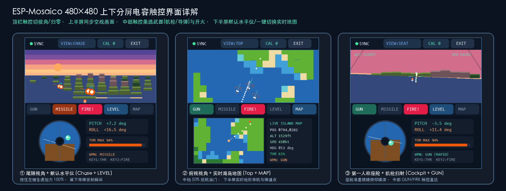
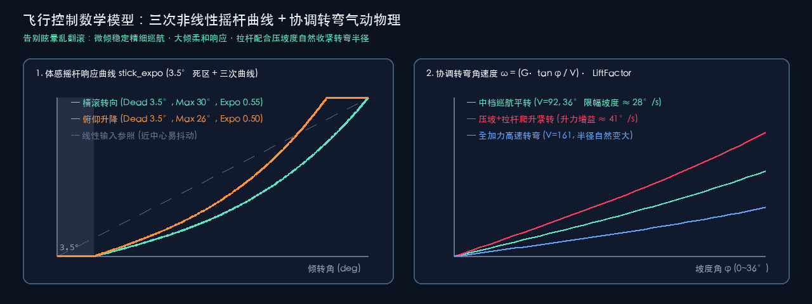
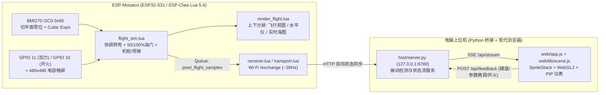

# ✈️ ESP32-Mosaico-Lab · Pixel Flight 双端同步像素空战游戏

[](https://github.com/WUHAO19831214/ESP32-Mosaico-Lab-Pixel-Flight-Game)
[](https://github.com/WUHAO19831214/ESP32-Mosaico-Lab-Pixel-Flight-Game)
[](https://github.com/WUHAO19831214/ESP32-Mosaico-Lab-Pixel-Flight-Game)
[](https://github.com/WUHAO19831214/ESP32-Mosaico-Lab-Pixel-Flight-Game)

> **WUHAO 的 `ESP32-Mosaico-Lab` 系列作品**：将 **乐鑫 ESP-Mosaico (`ESP32-S31`, `480×480` 电容触控屏 + Bosch `BMI270` 六轴陀螺仪 + 机械按键)** 变身为一台兼具**体感飞行摇杆、武器发射器、实时水平仪与航海地图**的像素空战掌机，并与电脑大屏 **SpriteStack + WebGL2** 战机画面毫秒级同步！



本项目融合并重构了开源项目 [**W-Mai/mirui (`pixel-flight`)**](https://github.com/W-Mai/mirui/tree/main/gallery/pixel-flight) 的高帧率像素体素渲染引擎与 [**tenntsitinn/iterx-fly**](https://github.com/tenntsitinn/iterx-fly) 的板载轻量化飞行仪表思路，在不刷写设备固件（零破坏出厂 ESP-Claw / `edge_agent 0.4.0` 系统）的前提下，打造了一套 **ESP32 实体掌机 + 桌面高帧率大屏** 双端同步可玩的空战飞行游戏。

---

## 🎮 核心玩法与六大技术亮点

1. **双端同源、无缝同步**：ESP32 与电脑端共用同源 `seed=7, land=0.33` 航海群岛地形（`world128.bin`），ESP32 作为权威物理端以 ~30Hz 通过 Wi-Fi 局域网同步航迹与武器事件，电脑端以 60~144 FPS 航位平滑插值渲染。
2. **拟真摇杆曲线 + 协调转弯气动模型**：采用 **±3.5° 中心死区 + 三次非线性 S 曲线（Cubic Expo）** 配合 $\omega = \frac{G \tan\phi}{V}$ 空气动力学压坡协调转弯——小倾转细腻修正航向，拉杆抬机头的同时自然收紧转弯半径，彻底去除令人眩晕的意外翻滚特技。
3. **双武装系统（机枪 + 导弹）双端同步特效**：机械右键 `GPIO 10`（或桌面 `J` / 鼠标点击）即可开火，支持**双联高速曳光机枪**与**翼下交替发射白烟尾迹导弹**，在 ESP32 小屏与电脑 3D 大屏上同步呈现弹道与像素爆炸火球。
4. **ESP32 480×480 上下分屏触控座舱**：上半屏实时渲染飞行空战视角，中部触控条直接切换武器/开火/仪表，下半屏**默认显示双轴水平仪与油门条**，一键点选即可切换为**实时滚动海岛战术地图**。
5. **0ms 任意握持角即刻归零**：基于 3D 重力切平面投影与陀螺仪互补滤波，无论你正坐平端还是斜靠沙发握持，点击 `CAL 0`（或 `C` 键）0ms 立即标定当前姿势为水平基准，绝无万向锁。
6. **四槽位安全共存 & 离线直接试玩**：不刷机、不抢占其他 ESP-Mosaico 应用（如状态牌、日语学习终端），断连或无开发板时浏览器也可直接用 `WASD` / 鼠标全功能试玩。

---

## 🖥️ 桌面端三视角实机渲染画廊

电脑端基于体素堆叠（SpriteStack）与 WebGL2 流体尾焰着色器渲染，支持**白昼 / 日落 / 黑夜**切换、`0~2` 架自动编队僚机、以及三种沉浸视角：



- **① 俯视群岛视角（Overhead）**：经典街机斜 45° 体素层叠质感，清晰展示岛屿海岸浅滩、森林起伏与战机翼尖凝结尾迹。
- **② 日落尾随视角（Chase · Sunset）**：镜头紧随战机后上方，压坡转弯时两侧编队僚机、双引擎加力火焰与发射出的导弹尾烟一览无余。
- **③ 第一人称座舱视角（Cockpit HUD）**：真实模拟座舱盖反光、随横滚倾斜的天海地平线、绿色 HUD 准星、雷达与三联机械仪表盘。
- **多功能左下角小窗（按 `D` 切换显隐）**：内置 **双轴水平仪**、**实时海岛地图**（与板载 `MAP` 联动）、**实时遥测监控**、**摇杆手感微调**（支持反转俯仰/转向、交换 XY 轴与 0.5x~1.8x 灵敏度实时下发）。

---

## 📟 ESP32 板载 480×480 上下分屏触控界面详解

为了不浪费右侧实体机械按键在“切视角”上，本系统将**视角切换、武器选择、水平仪/地图切换**全部做到直观的电容触控热区中，把两颗清脆的机械键专门留给**油门控制**与**武器开火**：



| 屏幕区域（480×480） | 控件与内容 | 交互功能 |
| :--- | :--- | :--- |
| **顶部触控栏 (`y=0..44`)** | `SYNC/LOCAL` · `[VIEW:...]` · `[CAL 0]` · `[EXIT]` | 触屏点击 **`VIEW`** 循环切换 `俯视 / 尾随 / 座舱`；点 **`CAL 0`** 0ms 姿态归零；点 **`EXIT`** 安全释放硬件句柄并退出 |
| **上半屏主视口 (`y=45..239`)** | 实时飞行画面 + 弹道火球 | 同步渲染俯视海岛 / 尾随战机 / 座舱 HUD，以及曳光弹、导弹烟迹与触地爆炸火球 |
| **中部战术触控条 (`y=240..286`)** | `[GUN]` `[MISSILE]` `[FIRE!]` `[LEVEL]` `[MAP]` | 点选 **`GUN`（机枪）** 或 **`MISSILE`（导弹）**；按住 **`FIRE!`** 触屏开火；切换下半屏显示 **`LEVEL`** 或 **`MAP`** |
| **下半屏默认：水平仪 (`y=287..480`)** | 人工地平仪 + 气泡水平仪 + 油门条 | 直观展示相对姿态球、`PITCH/ROLL` 角度、**油门档位 (`THR MID 50%` / `MAX 100%`)** 及当前武装状态 |
| **下半屏切换：实时地图 (`y=287..480`)** | 彩色群岛实时海图 + 航向箭头 + 导航数值 | 北向上实时滚动渲染海水、沙滩、植被、山地、本机航向、实时射出的导弹/机枪弹着点及 `POS / ALT / SPD / HDG` |

---

## 📐 拟真飞行摇杆非线性曲线与协调转弯气动模型

针对手持体感容易“微调太贼、大角度又容易误触发转圈翻滚”的痛点，我们完全重写了 IMU 解算与飞行动力学：



1. **BMI270 切平面零位标定与三次指数曲线（`app/scripts/imu.lua`）**：
   - 将加速度计与陀螺仪互补融合后的重力向量 $u$ 投影至零位切平面（`right_vec`, `fwd_vec`），避开欧拉角奇异点。
   - 对倾斜角 $\theta$ 施加 $\pm 3.5^\circ$ 死区后应用飞行摇杆标准 S 曲线：
     $$y(\theta) = \operatorname{sign}(\theta)\Big[(1 - e)\,u + e\,u^3\Big], \quad u = \operatorname{clamp}\left(\frac{|\theta| - 3.5^\circ}{\theta_{\max} - 3.5^\circ},\, 0,\, 1\right)$$
     其中横滚 $\theta_{\max} = 30^\circ, e = 0.55$；俯仰 $\theta_{\max} = 26^\circ, e = 0.50$。
2. **协调压坡转弯物理（`app/scripts/flight_sim.lua` & `web/lib/scene.js`）**：
   - 最大坡度角 $\phi$ 限制在 $\pm 36^\circ$ 内，完全移除特技桶滚自旋，确保机头与地面参考清晰稳定。
   - 转弯角速度遵循空气动力学协调转弯方程：
     $$\omega = \frac{G \tan\phi}{V} \cdot (1 + 0.65 \max(0, \text{climb\_stick}) - 0.15 \max(0, -\text{climb\_stick}))$$
     左倾即压左坡协调左转，右倾即压右坡协调右转，压坡同时轻微上抬拉杆会自然收紧盘旋半径；松手回正即平滑改平直飞。

---

## 🕹️ 硬件按键、体感与桌面快捷键全映射表

| 控制方式 | 动作 | 游戏响应（双端实时同步） |
| :--- | :--- | :--- |
| **ESP-Mosaico 体感** | 左右倾转 / 上抬下压俯仰 | 压坡协调左/右转弯（限幅 `±36°`） / 抬头拉起爬升与低头俯冲 |
| **右侧子板左键 (`GPIO 11`)** | **默认松开 / 按住不放** | 默认 **中档巡航油门（`50%`）**；**按住**开启 **全加力燃烧室（`100%`, `1.75x` 极速）** |
| **右侧子板右键 (`GPIO 10`)** | **短按 / 按住** | 发射当前选中的武器：**导弹（默认，翼下交替发射+烟迹）** 或 **机枪（高速双联连射）** |
| **480×480 电容触屏** | 顶栏 & 中部触控条 | 切换视角 (`VIEW`)、姿态归零 (`CAL 0`)、切换 `GUN / MISSILE`、触屏开火 (`FIRE!`)、切换 `LEVEL / MAP` |
| **电脑键盘 & 鼠标** | `WASD`/方向键、`Shift`、`G`、`J`/鼠标左键 | 方向操纵、加力、切武器(`G`)、开火(`J`/左键)；支持 `Space/1/2/3` 切视角、`L` 水平仪、`M` 地图、`T` 昼夜、`F` 僚机、`C` 归零 |

---

## 🏗️ 双端同步系统架构



### 目录结构

```text
.
├── app/                              # ESP-Mosaico 设备端 Lua 5.4 应用 (/nand/apps/pixel_flight)
│   ├── launcher.json                 # Works -> Installed -> 像素飞行 入口描述
│   ├── config.example.json           # 随机配对令牌模板
│   ├── assets/
│   │   ├── bmi270-config.bin         # Bosch BMI270 初始化固件（含 BMI270-LICENSE）
│   │   ├── world128.bin              # 与桌面端同源的 128×128 群岛地形采样表
│   │   └── icon.jpg                  # 128×128 应用图标
│   └── scripts/                      # imu / flight_sim / render_flight / main / receiver / ownership 等
├── host/                             # Mac / PC 端 Python 零依赖本地桥接与设备部署脚本
│   ├── configure.py                  # 生成独立 0600 权限本地配对配置
│   ├── device.py                     # 增量上传、SHA256 读回校验、启停与安全切回其他应用
│   └── server.py                     # 被动式 HTTP/SSE 桥接服务器 (127.0.0.1:8780)
├── web/                              # 桌面高帧率渲染端（原生 ES Module + WebGL2，零打包构建）
│   ├── index.html                    # HUD 控制台与多功能悬浮仪表面板
│   ├── app.js                        # 渲染主循环、双轴水平仪、实时彩图与摇杆调参
│   ├── mosaico-link.js               # 无感重连 SSE 链路与指令确认
│   └── lib/{scene,cockpit,flame-layer,jet-model}.js
├── rust-adapter/mosaico_sync.rs      # 可选：用于原生 Rust/WGPU 版像素飞行的串口/HTTP 同步适配模块
├── docs/                             # 架构设计文档与视觉展示素材
├── scripts/                          # 地形纹理、图标与 README 可视化生成脚本
├── tests/                            # Lua 5.4 离线屏幕仿真、Mock 桥接及 Web 同步单元测试
├── 启动像素飞行双端同步.command       # macOS 一键启动桌面端与桥接服务
└── 部署像素飞行到ESP32.command        # macOS 一键校验上传并注册设备 Works 入口
```

---

## 🚀 快速上手指南

### 场景 A：无需 ESP32，立即在电脑上离线试玩
桌面端零第三方依赖，仅需 **Python 3.10+** 与现代浏览器：

```sh
git clone https://github.com/WUHAO19831214/ESP32-Mosaico-Lab-Pixel-Flight-Game.git
cd ESP32-Mosaico-Lab-Pixel-Flight-Game
python3 host/server.py --port 8780
```
浏览器打开 `http://127.0.0.1:8780`，使用 `WASD`/方向键飞行、`Shift` 加力、`G` 切武器、`J`/左键发射、`Space` 切视角、`L/M` 打开水平仪与实时地图！

### 场景 B：搭配 ESP-Mosaico (`ESP32-S31`) 双端联调

1. **首次配对（生成独立随机令牌，不覆盖已有设备数据）**：
   ```sh
   python3 host/configure.py <你的ESP-Mosaico局域网IP>
   ```
   > 若希望手动配置，也可参考 `bridge.example.json` 创建 `bridge.local.json` 并保证 `app/config.json` 中 `token` 一致。
2. **上传应用到设备并注册入口**：
   - 若设备前台正在运行其他应用，请先从屏幕右上角退回桌面；
   - 运行一键脚本或终端执行：
   ```sh
   python3 host/device.py upload
   python3 host/device.py recover
   ```
   - `upload` 会逐文件上传至 `/nand/apps/pixel_flight` 并执行 SHA256 逐字节读回校验。
3. **启动并起飞**：
   - 运行 `python3 host/server.py`（或双击 `启动像素飞行双端同步.command`）；
   - 打开 `http://127.0.0.1:8780` 点击左上角 **“连接 ESP-Mosaico”**（或在设备 **Works → Installed → 像素飞行** 打开后再刷新网页，网页会自动续接在线会话）；
   - 以最舒适的角度握好板子，点击屏幕 `CAL 0` 或按 `C` 键，即刻起飞！

### 多应用共存与安全约束
- 本应用遵循 ESP-Claw **4 Lua 任务槽位** 与共存准则：**不刷写固件、不停止或重启其他项目的后台接收器或系统服务**；
- `host/server.py` 启动与断线重连严格保持被动，绝不在后台自动抢占设备屏幕；
- 马达 `GPIO 8` 强制拉低保护，`GPIO 38` RGB 灯带启动清空后释放句柄，退出 UI 时自动清理并恢复借用的 BMI270 寄存器。

---

## 🧪 自动化测试

离线仿真测试覆盖 BMI270 寄存器借用/恢复、三次非线性摇杆曲线、协调转弯物理、480×480 分屏像素坐标整型校验、Mock HTTP 桥接与浏览器状态零漂移同步（测试需 Python `lupa`、`Pillow` 与 `Node.js 20+`）：

```sh
# 1. Lua 5.4 全链路 + 480x480 屏幕渲染仿真 + HTTP 桥接测试
python3 -m unittest discover -s tests -p 'test_*.py' -v

# 2. 桌面 SpriteStack 引擎与武器同步零漂移测试
node --test tests/web_sync.test.mjs
```

---

## 🙏 致谢与参考来源
- 桌面端体素堆叠与 WebGL2 流体尾焰渲染源自 [**W-Mai/mirui (`gallery/pixel-flight`)**](https://github.com/W-Mai/mirui/tree/main/gallery/pixel-flight)
- ESP32 板载轻量化仪表灵感参考 [**tenntsitinn/iterx-fly**](https://github.com/tenntsitinn/iterx-fly)
- Bosch BMI270 初始化微码遵循 [`app/assets/BMI270-LICENSE`](app/assets/BMI270-LICENSE)
