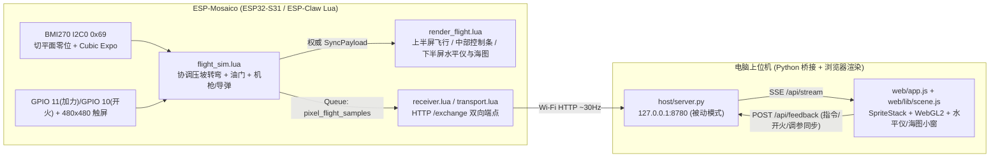

# 《合并架构与硬件引脚接线方案》（ESP-Mosaico 最终实机方案）

> **硬件平台**：**乐鑫 ESP-Mosaico 开发套件（主控 `ESP32-S31`，出厂 ESP-Claw / `edge_agent 0.4.0` Lua 5.4 运行时）**。

## 1. 实机硬件与运行时规范

| 硬件/软件子系统 | 实机核验规格 | 本项目设计约束 |
| :--- | :--- | :--- |
| **主控芯片与系统** | `esp_mosaico` / **ESP32-S31** (`esp32s31`)，**ESP-Claw (`edge_agent 0.4.0`)** Lua 5.4 | 不刷写裸机固件、不重启设备；部署为 `/nand/apps/pixel_flight`（Works 入口：**像素飞行**）。 |
| **板载屏幕与触控** | `480×480` 电容触摸屏（CO5300，`display.open()`） | 上下分屏布局；所有绘图坐标与半径必须为 **Lua 整数**；顶部 `EXIT` 安全退出。 |
| **六轴 IMU（BMI270）** | I2C0 (`i2c.new(0, 0, 1, 400000)`) 地址 **`0x69`**（`chip_id = 0x24`） | 支持 `configured`（向传感器 RAM 加载 `8192B bmi270-config.bin`）与 `borrowed_active`（只读借用）双模式；退出恢复寄存器。 |
| **机械按键与外设** | 左键 **`GPIO 11`**、右键 **`GPIO 10`**（低有效）；RGB **`GPIO 38`**；马达 **`GPIO 8`** | **稳定性**：`GPIO 8` 强制拉低 `0`；`GPIO 38` 启动清空一次后即释放句柄。 |
| **PC 通信通道** | Wi-Fi 局域网 `http_server` ↔ 本地 Python HTTP/SSE 桥接（`127.0.0.1:8780`） | ~30 Hz 双向状态交换 + 桌面端 60~144 FPS 航位平滑插值。 |
| **四槽位共存规则** | 最多同时运行 **4 个 Lua 任务** | 提供独立接收器 `receiver.lua` 与零额外槽位扩展 `transport.lua`，完整设备路径精确交接。 |

## 2. 双端同步与上下分屏架构

## 3. 按键、体感与双端交互映射表

| 输入方式 | 动作 | 响应功能（ESP32 本地屏 & 电脑大屏严格同步） |
| :--- | :--- | :--- |
| **体感倾转（BMI270）** | 左右倾转 / 上抬下压 | 三次非线性摇杆曲线 + `±36°` 限幅协调压坡转弯 / 抬头拉起与低头俯冲（无翻滚特技） |
| **左机械键 (`GPIO 11`)** | **默认松开 / 按住** | 默认 **中档巡航油门 (`50%`)**；**按住**持续开启 **全加力燃烧室 (`100%`)** |
| **右机械键 (`GPIO 10`)** | **短按 / 按住** | 发射当前选中的武器：**导弹（默认，翼下交替发射+烟迹）** 或 **机枪（双联高速连射）** |
| **板载 480×480 触屏** | 顶栏 & 中部触控条 | 顶栏：`[VIEW]` 切视角、`[CAL 0]` 归零、`[EXIT]` 退出；中部：`[GUN]` `[MISSILE]` `[FIRE!]` `[LEVEL]` `[MAP]` 切换下半屏水平仪/实时地图 |
| **电脑键盘与鼠标** | `WASD`/方向键、`Shift`、`G`、`J`/点击、`Space/1/2/3`、`L/M/C` | 离线时独立试玩；联机时同步至 ESP32，左下角面板支持水平仪、实时地图、遥测与轴向微调 |
